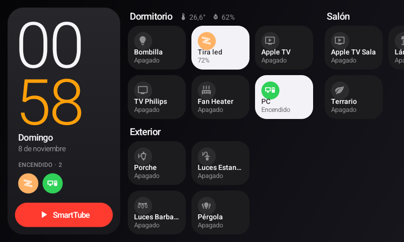
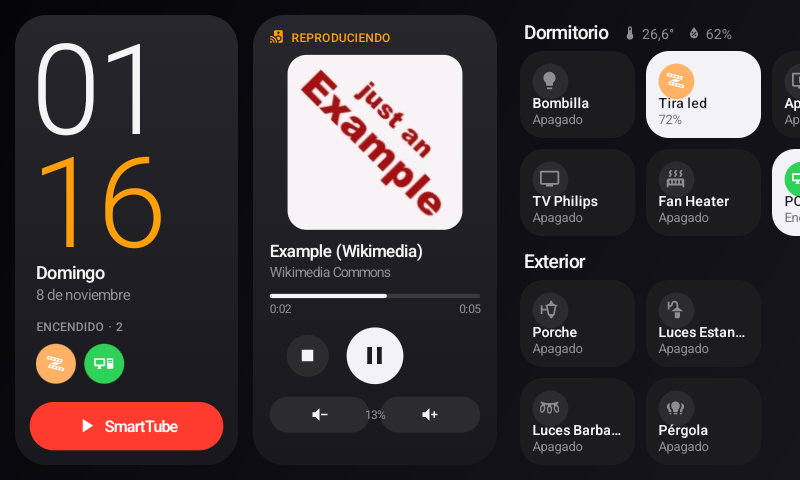
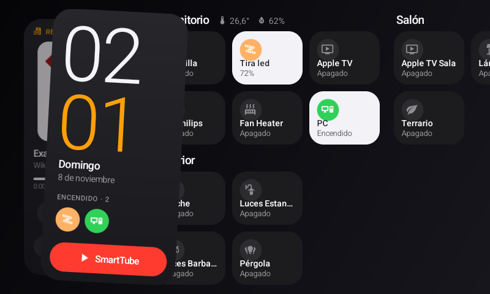
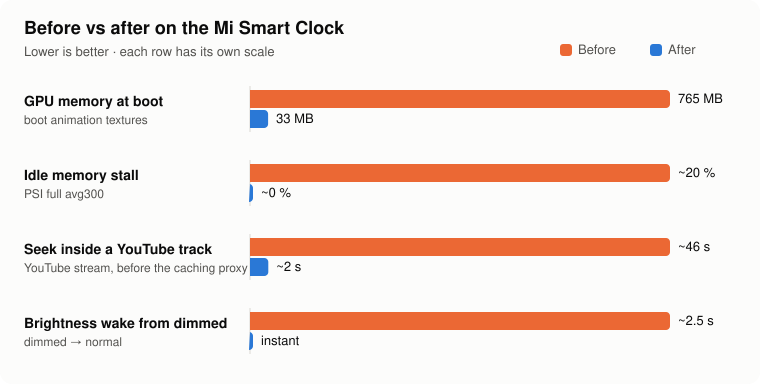

# MiSmartClock-Light

Turn a **Xiaomi Mi Smart Clock (LX04)** running a custom Android 13 GSI into a fast, stable little
**Home Assistant panel, music speaker and YouTube screen** — squeezing everything out of its 1 GB of RAM.

The heart of it is **Casa**, a tiny native app (~100 KB, zero dependencies) that is at the same time the
clock's home screen, a Home Assistant dashboard and a **DLNA/UPnP music receiver** that Home Assistant and
Music Assistant discover on their own. Around it there is a set of device fixes that stop the clock from
crashing on boot and thrashing at idle.



> Download the APK from **[Releases](https://github.com/datingesp-hash/MiSmartClock-Light/releases/latest)**.

## Features

- **Home Assistant dashboard** — Apple-style dark UI, rooms with tap-to-toggle tiles, long-press panels for
  brightness / colour temperature, media controls and TV inputs, inline sensors. Live updates over the HA
  WebSocket API (only the entities on screen), optimistic UI.
- **Home screen** — replaces Launcher3: big clock, "what's on" bubbles (tap to turn off), one-tap SmartTube
  button, long-press the time for Android Settings.
- **Music receiver ("Mi Smart Clock")** — a UPnP AV MediaRenderer written from scratch: SSDP discovery,
  SOAP control, GENA events, gapless next track, volume. Shows up in Home Assistant as a `media_player`,
  works with Music Assistant, BubbleUPnP, VLC… A **Now Playing** card with artwork, progress and big
  controls slides in front of the clock when music starts.
- **Fast YouTube streams** — a local caching proxy makes YouTube Music tracks start and seek in ~2 s
  instead of ~46 s.
- **Glanceable screen** — stays on (dimmed) while the room light is on, turns off in the dark, wakes up
  instantly when you bring your hand close (raw IR proximity reading).
- **Top button remapped** — 1 press = play/pause, 2 presses = screen on/off.
- **English and Spanish** UI (follows the system language, or set `"language"` in the config).

| | |
|---|---|
|  |  |

<sub>Screenshots taken with the Spanish UI.</sub>

## Before vs after



Out of the box (custom GSI, Launcher3, a web dashboard in Fully Kiosk) the clock was barely usable: it
stalled constantly, crashed `system_server` on every boot and sometimes rebooted with
`Kernel panic - Out of memory`. Here is what changed and why:

| | Before | After | What did it |
|---|---|---|---|
| **Boot** | GPU memory peaked at **~765 MB**, `system_server` hung ~2 min and restarted | GPU peak **33 MB**, clean boot in ~2 min | The 1080×360, 480-frame boot animation was kept as GPU textures → disabled with a Magisk module |
| **Memory pressure at idle** | PSI "full" **~20 %**, 350 MB in swap: thrashing | PSI **~0** | VM + lmkd tuning, unused apps disabled, apps AOT-compiled |
| **App compilation** | **0 of 47** apps compiled (everything on JIT: more CPU, more RAM) | SmartTube, Casa and 8 system apps AOT-compiled, re-checked every 6 h | `installd` can't run `dex2oat` on kernel 4.14 (no `pidfd_open`) → manual `dex2oat` as root |
| **Kernel free-memory reserve** | `min_free_kbytes` 2.8 MB, lmkd reacted late | 8 MB, lmkd reacts earlier and kills the heaviest app | Boot script |
| **Background junk** | ~45 useless system apps, `android.process.media` crash loop, multidisplay + AudioFX always running (~100 MB) | Disabled / removed for user 0 (reversible) | `device/disabled-packages.txt` |
| **Dashboard** | HA web UI in a WebView (Fully Kiosk): **100–150 MB RAM**, network always on | Casa: native, **~100 KB APK, ~5 MB GPU**, disconnects from HA when not visible | Casa |
| **Home screen** | Launcher3 + app drawer | Casa is the launcher, SmartTube one tap away | Casa |
| **Music** | No way to send music to the clock (Google Cast receivers need Google certificates) | Built-in DLNA receiver, discovered by Home Assistant / Music Assistant | Casa |
| **YouTube Music seek** | **~46 s** (Android's WebM extractor scans the whole file; YouTube throttles full downloads) | **~2 s** start and seek | Casa's local caching proxy (1 MB `Range` chunks) |
| **Dimmed → bright** | ~2.5 s brightness ramp | Instant | Framework overlay with brightness ramp = 0 |
| **Screen at night** | Always on or always off | Dim while the room light is on, off in the dark, wakes on hand proximity | Casa + Home Assistant |
| **Clock** | 1 h off (no telephony/location → stuck on GMT) | Correct time zone | Manual time zone at install |

Still open: an occasional out-of-memory reboot after long SmartTube sessions — see
[docs/KNOWN-ISSUES.md](docs/KNOWN-ISSUES.md).

## Requirements

- Xiaomi Mi Smart Clock (LX04), MediaTek MT8167S, 1 GB RAM, 800×480.
- Unlocked, running an **Android 13 GSI** with root. Tested on LineageOS 20 phh GSI `lineage_a64_bvS`
  (userdebug) with **phh-su** (`/system/xbin/su`) and **Magisk 25.2** (for `service.d` and modules).
  Flashing the GSI is out of scope here — follow the community guides for the LX04.
- A computer with `adb`. To build from source: Android SDK (build-tools 36, platform 36) and JDK 17+.
- Home Assistant with a long-lived access token (for the dashboard; the music receiver works without it).

## Quick start

```bash
git clone https://github.com/datingesp-hash/MiSmartClock-Light && cd MiSmartClock-Light

# 1. Device fixes (root via phh-su). Read docs/DEVICE.md first.
device/install.sh                          # TZ_ID=Europe/London device/install.sh to force a time zone
adb reboot

# 2. Casa: copy and edit the config (HA URL, token, rooms, entities)
cp app/config.example.json ~/casa-config.json
APK=~/Downloads/Casa-v1.18.apk app/deploy.sh ~/casa-config.json   # or omit APK= to build from source
```

Full walkthrough: **[docs/INSTALL.md](docs/INSTALL.md)**.

## Documentation

| | |
|---|---|
| [docs/INSTALL.md](docs/INSTALL.md) | Step-by-step installation, updating and uninstalling |
| [docs/APP.md](docs/APP.md) | Casa: screen, interaction, configuration reference, music receiver, architecture, building |
| [docs/DEVICE.md](docs/DEVICE.md) | Diagnosis and every change made to the clock, with how to undo it |
| [docs/MUSIC.md](docs/MUSIC.md) | Sending music to the clock (Home Assistant, Music Assistant, phone apps) |
| [docs/KNOWN-ISSUES.md](docs/KNOWN-ISSUES.md) | Known problems, how to debug them, ideas |
| [CHANGELOG.md](CHANGELOG.md) | Release history |

## Repository layout

```
app/        Casa (Java, no Gradle): src/, res/, assets/ (UPnP service descriptions), build.sh, deploy.sh
device/     install.sh, boot scripts (service.d), manual AOT (aot.sh), Magisk module, framework overlay,
            key layout, package lists, diagnostic tools
docs/       Documentation and images
examples/   Music Assistant docker-compose
```

## Credits

- Icons: [Material Design Icons](https://pictogrammers.com/library/mdi/) (Pictogrammers, Apache 2.0).
- [SmartTube](https://github.com/yuliskov/SmartTube) for YouTube on the clock.
- Built with the help of Claude Code.

## License

[MIT](LICENSE). Icons keep their own Apache 2.0 license.
