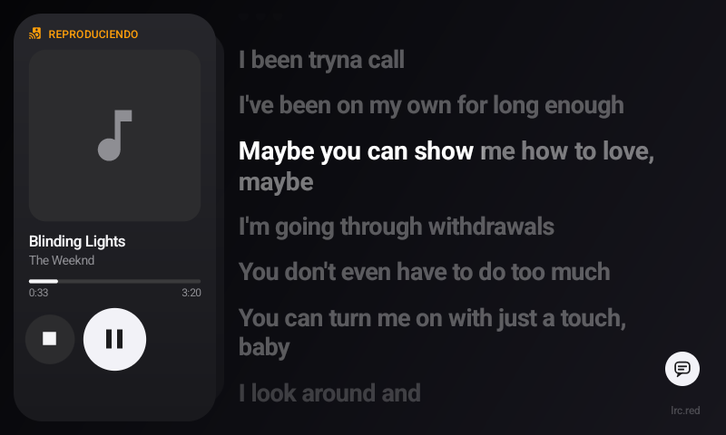

# Casa: Home Assistant panel, home screen and music receiver

Native app for the Mi Smart Clock: clock, home status and Home Assistant control with a minimal Apple-style
look (dark theme, rounded cards). It is also the clock's **home screen** and a **DLNA music receiver**.

## Why native and not web

The Home Assistant web UI, the official companion app or Fully Kiosk all load a full browser (WebView):
**100–150 MB of RAM** on a 1 GB device. Casa is plain Java on the Android framework:

| | Casa |
|---|---|
| APK | ~100 KB (including the DLNA receiver) |
| Dependencies | none (no AndroidX, Kotlin, OkHttp or WebView) |
| GPU memory | ~5 MB |
| Background network | none: disconnects from HA in `onStop` |
| Redraws | only the card that changes; the clock once a minute (`ACTION_TIME_TICK`) |

## Screen

- **Left, clock card (portrait)**: hours in white and minutes in orange, stacked; weekday and date;
  bubbles with the icon of everything that is on (tap one to turn it off); **SmartTube** button at the bottom.
  If the connection to HA is lost it shows "OFFLINE".
  - **Long-press the time** → Android Settings (escape hatch: there is no app drawer).
- **Right, rooms**: name on the left and a 2-row grid of its entities underneath.
  At most 2 rooms per column; the rest is reached by scrolling right.
  - **Zoom** (capsule in the bottom-right corner, `ZoomSwitch.java`): left = overview (2 rooms per column);
    right = **one room per column**, full height, with bigger tiles (tile contents scale up to ×1.45) and
    scrolling that snaps to the start/end of each room. Tap to toggle (or drag the thumb); the change is
    animated (fade + scale around the room in view) and remembered across launches.
  - **Sensors** are not tiles: they appear next to the room name, in grey with a small icon (`26.6° 62%`).

## Interaction

| Entity | Tap | Long-press |
|---|---|---|
| `light` | on/off | panel with brightness and colour temperature (if supported) |
| `switch`, `fan`, `input_boolean` | on/off | (if it has `inputs`) panel with input buttons |
| `media_player` | panel: previous / play-pause / next, volume, power | same |
| `sensor` | — | — |

Changes show instantly (optimistic) and are corrected with the real state HA sends back.
Back only closes the open panel; Casa never closes because it is the launcher.

## Music receiver (DLNA/UPnP)

Casa includes its own **UPnP AV MediaRenderer** ("Mi Smart Clock") in plain Java, running in a foreground
service (`DlnaService`) so it stays available while another app (SmartTube) is in front.

- **SSDP discovery** (239.255.255.250:1900): answers `M-SEARCH` (from port 1900, so firewalls on the
  searcher accept the reply; also with the screen off, see [DEVICE.md](DEVICE.md#wi-fi-multicast-with-the-screen-off)) and announces `ssdp:alive` every 5 min
  (`ssdp:byebye` on stop). Home Assistant finds it under *Integrations → DLNA Digital Media Renderer*.
- **HTTP on port 49494**: `/desc.xml` (device description) and the SCPDs in `app/assets/`.
- **SOAP control**:
  - AVTransport: `SetAVTransportURI`, `SetNextAVTransportURI` (gapless next track), `Play`, `Pause`,
    `Stop`, `Seek` (REL_TIME/ABS_TIME), `Next`, `Previous` (restarts the track), `Get*Info`.
  - RenderingControl: volume and mute (= `STREAM_MUSIC`, 0–100).
  - ConnectionManager: accepted protocols (`audio/*`: MP3, AAC/M4A, FLAC, WAV, OGG/Opus…).
- **GENA events** (`SUBSCRIBE`/`UNSUBSCRIBE`, `LastChange`): controllers (HA, BubbleUPnP…) see changes instantly.
- **Playback** with the system `MediaPlayer`: audio focus (if SmartTube starts playing the music pauses, and
  vice versa), partial wake lock and high-performance Wi-Fi lock **only while playing** (otherwise Wi-Fi stays
  in power-save: less heat).
- **Now Playing card**: shares the slot with the clock. **When music starts** (and nothing was playing) it
  comes to the front with an animation; track changes within a queue don't move it. Otherwise it waits
  **behind the clock**, peeking out on the right; **swipe right to swap** them (the front card tilts out to the
  right over the rooms and goes behind while the other grows; the drag drives the animation and the swap
  completes under your finger, without lifting it — one swipe swaps at most once, so a long swipe can't land
  back on the card you started from — `CardStack.java`,
  with its own frame loop because system animations are off on the clock). It shows the artwork
  (`upnp:albumArtURI`, downscaled in RGB_565), title, artist, progress (tap to seek) and three big buttons:
  stop (clears the queue and hides the card), play/pause and next (if the controller sent a next track).
  Volume is controlled from the controller (HA) or the hardware buttons.
- **Local caching proxy** (`StreamProxy.java`) for internet URLs: Android 13's WebM extractor can't seek in
  audio-only files ("Did not locate the video track for seeking") and reads the whole file; against YouTube,
  with small requests, seeking to mid-song took **~46 s**. On top of that YouTube throttles full-file downloads
  to ~35 KB/s but serves `Range` chunks at ~11 MB/s. Casa downloads each track in 1 MB chunks into a temp file
  and `MediaPlayer` reads it from `127.0.0.1` with `Range`: **~2 s to start, ~2 s to seek**. Local network
  sources (Music Assistant) are played directly, and streams with no length (live radio) are redirected to
  the origin.
- Receiver name: `"receiver_name"` in `config.json` (default "Mi Smart Clock").

Files: `DlnaService.java` (service), `Upnp.java` (SSDP + HTTP + SOAP + GENA), `Renderer.java` (player and
state), `StreamProxy.java` (caching proxy), `NowPlayingView.java` (card).

Tested with [`async-upnp-client`](https://github.com/StevenLooman/async_upnp_client) (the library behind Home
Assistant's DLNA integration, `DmrDevice` profile): load, play, pause, seek, stop, position/duration/volume.

How to send music to it: [MUSIC.md](MUSIC.md).

## Synced lyrics



<sub>Spanish UI.</sub>

- **Round lyrics button** (top-right corner of the Now Playing card, `LyricsButton.java`): it lives in the
  card, so it is only there with music and moves with the card when you swipe. Tap it and the Now Playing card comes to the front (if the
  clock was there) while **the lyrics take over the whole rooms area**; the button turns white. Tap it again to
  hide only the lyrics (the music card stays). Swiping to the clock card, the music ending or Back also hide them.
- **Apple Music style** (`LyricsView.java`): big bold lines; the line being sung is white and slightly larger,
  the rest dimmed; syllable-timed lyrics fill in with a soft edge; the list glides to keep the current line in
  the upper third, the lines below following a beat later (a gentle wave); long instrumental breaks are three
  breathing dots that light up as the vocals come back; Apple duets put the second voice on the right. Drag to
  look around (it comes back after 3.5 s); **tap a line to seek** there. Unsynced lyrics scroll along with the
  song. The source is shown, small, in the bottom-right corner.
- **Brightness**: with the lyrics on screen and music playing, Casa dims the screen itself instead of the
  system (whose dim level is 5 %, unreadable): after the screen timeout it glides down to **30 %**
  (`LYRICS_DIM` in `MainActivity`) and stays on; a touch or a hand in front of the clock brings full brightness
  back. Paused or with the lyrics closed, the normal system behaviour returns.
- **Cost**: 60 fps only while something moves, ~30 fps while a line is being swept, otherwise it sleeps until
  the next line starts (≈20–30 % of one core while singing, ~2 % with the lyrics closed).
- **Sources** (`LyricsSources.java`, ported from [BitChord](https://github.com/kushagrasinghx/BitChord) — same
  providers, order and race): all of them are asked **at once** and answers are taken in priority order; a synced
  one (per syllable or per line) wins outright, plain text is only a fallback, and Genius is only asked when
  nobody else had anything. First, BiniLyrics identifies the recording (ISRC, max 2.5 s) so lrc.red and
  LyricsPlus can ask for that exact version. The last 8 songs are cached.

  | Source | What it gives |
  |---|---|
  | lrc.red, BiniLyrics, BetterLyrics | Apple Music TTML, per syllable |
  | BetterLyrics Portato | QQ Music QRC, per syllable (title/credit lines at the start are dropped) |
  | PaxSenix: Spotify / Musixmatch | need `paxsenix_key`; not asked without one |
  | LyricsPlus | per syllable, on volunteer mirrors raced against each other (often down) |
  | Unison | contributed by listeners (TTML, LRC or text) |
  | YouTube captions / YouTube Music | find the video by title + artist on YouTube Music (title and artist must match, so it never brings another song); timed captions / the Lyrics tab (plain text) |
  | KuGou, LRCLIB | per line |
  | Genius | plain text (no `[Chorus]` headers), last resort |

  **Musixmatch direct is not included**: BitChord takes the signing key out of Musixmatch's web client, which
  is getting around its access control; Musixmatch is available through PaxSenix with a key instead. Requests
  carry Casa's own User-Agent (sharing another app's one gets you its rate limits).

## Screen on, dimmed or off

Made to read the time at a glance without the screen always at full brightness:

- **Room light on** (according to HA): the screen doesn't turn off; after 1 min without touches it **dims**
  (brightness ~14/255) and comes back instantly when touched. If it was off when the light turns on, it turns
  on by itself. Casa holds a `SCREEN_DIM_WAKE_LOCK` while any of those lights is on.
- **Light off**: the screen turns off after 1 min without touches.
- Which lights count: `"room_lights"` in `config.json`; by default, the `light.*` entities of the first room.
- **Other things that keep it on**: `"keep_screen_on"`, any entity (e.g. your PC's switch): while it is `on`
  (or `playing` / `home`) the screen behaves as with the light on — dimmed, never off. It doesn't need to be
  on screen.
- With the screen off and Casa in front, the HA connection **is kept** to follow the light
  (with SmartTube in front it disconnects as usual).
- The clock's ambient light sensor is useless for this: it reads 1–2 lux with the light on.

**Presence (hand nearby)**: the IR proximity sensor (EM3071X) only reports "near" to Android at the driver's
threshold (96, a few cm away). `Presence.java` also reads the raw value (`/sys/bus/platform/drivers/als_ps/ps`,
~1 with nothing in front) every 200 ms and turns the screen on (or restarts its timeout) as soon as it goes
over 5: it reacts in ~0.1 s. Real range: a hand a few centimetres away — **it won't detect a person sitting
across the table**. If you turn the screen off with the button while your hand is in front, presence is
ignored until nothing has been detected for 20 s. Each reading leaves an `em3071x bingo ... ps_data=` line
in the kernel log (printed by the driver).

**Top button** (the mic-mute one): see [DEVICE.md](DEVICE.md#top-button). 1 press = play/pause Casa's music
(`Remote.java`, broadcast protected with `android.permission.DUMP`: only shell/root can send it),
2 presses = screen on/off.

## Configuration

`config.json` lives in the app's **private** storage (`/data/data/com.archie.casa/files/config.json`), never
inside the APK. `deploy.sh` copies it with root. Example: [`app/config.example.json`](../app/config.example.json).

```json
{
  "url": "http://192.168.1.10:8123",
  "token": "long-lived access token (HA → Profile → Security)",
  "rooms": [
    { "name": "Bedroom", "entities": [
      { "id": "light.bedside", "name": "Bedside", "icon": "lightbulb" },
      { "id": "switch.tv", "name": "TV", "icon": "television",
        "inputs": [ { "name": "PC", "icon": "monitor", "service": "script.tv_input_pc" } ] },
      { "id": "sensor.bedroom_temperature", "name": "Temperature", "icon": "thermometer" }
    ]}
  ]
}
```

| Field | Description |
|---|---|
| `url` | `http://host:8123` or directly `ws://host:8123/api/websocket` |
| `token` | Home Assistant long-lived access token |
| `rooms[].name`, `rooms[].entities[]` | rooms in display order; each entity has `id`, optional `name` and `icon` |
| `icon` | MDI name of one of the icons bundled in `res/drawable/ic_*.xml` (with dashes) |
| `color` | optional `#RRGGBB` to force the accent colour |
| `inputs` | optional; extra buttons in the panel that call an entity-less service (`domain.service`) |
| `room_lights` | optional list of the `light.*` in the clock's room (dimmed instead of off while any is on); default: the lights of the first room |
| `keep_screen_on` | optional list of any entities (a PC, a TV…) that also keep the screen on, dimmed when idle |
| `receiver_name` | optional DLNA receiver name |
| `language` | optional `en` or `es`; default: the system language (Spanish if it is Spanish, otherwise English) |
| `paxsenix_key` | optional PaxSenix API key: enables the "PaxSenix: Spotify" and "PaxSenix: Musixmatch" lyrics sources |
| `lyrics_sources` | optional list of lyrics sources in priority order (names from the table above); the ones left out are never asked |

Bundled icons: `apple`, `cast-audio`, `coach-lamp`, `desktop-tower-monitor`, `fan`, `fish`, `floor-lamp`,
`grill`, `hdmi-port`, `home-variant`, `leaf`, `led-strip-variant`, `lightbulb`, `lightbulb-group`,
`lightbulb-outline`, `monitor`, `music-note`, `outdoor-lamp`, `power`, `radiator`, `spa`, `string-lights`,
`television`, `television-play`, `thermometer`, `water-percent`.

To add an icon: download the SVG from [MDI](https://pictogrammers.com/library/mdi/) and create
`res/drawable/ic_<name>.xml` like the existing ones (24×24 vector with the `pathData`), then rebuild.

## Architecture

```
app/src/com/archie/casa/
├── Ws.java             Minimal RFC 6455 WebSocket client (text frames, ping/pong, no extensions)
├── Ha.java             HA session: auth, subscribe_entities, call_service, 30 s ping, reconnect with backoff
├── Config.java         Reads config.json (URL, token, rooms and entities)
├── Ui.java             Palette, typefaces, icons, state texts and language (en/es)
├── MainActivity.java   Builds the UI, wires HA to the views, lifecycle, launcher
├── ClockView.java      Clock card + "on" bubbles + SmartTube button
├── RoomView.java       Title + inline sensors + 2-row grid
├── TileView.java       One entity = one View drawn on a Canvas (no nested layouts)
├── DetailView.java     Modal panel: brightness/temperature sliders, media controls, TV inputs
├── CardStack.java      Clock and Now Playing card in the same slot, swipe to swap
├── NowPlayingView.java Now Playing card
├── ZoomSwitch.java     Rooms zoom capsule (overview / one room per column)
├── LyricsButton.java   Round lyrics button (corner of the Now Playing card)
├── LyricsView.java     Apple Music-style synced lyrics, in the rooms area
├── Lyrics.java         Model + parsers (LRC/enhanced LRC, Apple TTML, QRC/YRC, text) + HTTP/JSON helpers
├── LyricsSources.java  Lyrics providers (BitChord's) and the race between them
├── Presence.java       Proximity (raw value) and dimmed screen tied to the room light
├── Remote.java         Commands from the button daemon (PLAY_PAUSE)
└── DlnaService.java, Upnp.java, Renderer.java, StreamProxy.java   DLNA receiver (see above)
```

- **`subscribe_entities`** with a list of `entity_ids`: HA only sends initial states and compressed diffs
  (`a` / `c` / `r`) for the entities on screen.
- Threads: one I/O thread (`HandlerThread`) to connect and send, one reader per connection; state lives on
  the main thread.
- Sliders send at most every 350 ms while dragging, plus the final value on release.
- The socket has a 75 s `soTimeout`; with a ping every 30 s a dead link is detected and reconnected.

## Building

Requirements: Android SDK (`build-tools/36.0.0`, `platforms/android-36`) and JDK 17+. No Gradle:
`aapt2` → `javac --release 8` → `d8` → `zipalign` → `apksigner`.

```bash
app/build.sh                       # → app/Casa.apk, signed with ~/.android/debug.keystore
KS=release.jks KS_PASS=... KS_ALIAS=... app/build.sh   # sign with your own key
VC=20 VN=1.19 app/build.sh         # version code / name (Android refuses a lower versionCode)
app/deploy.sh ~/casa-config.json   # build + install + config + AOT + set as home screen
```

`deploy.sh` compiles the app with `/data/adb/aot.sh` because `installd` can't on this kernel
(see [DEVICE.md](DEVICE.md)). The boot script re-compiles it if a reinstall leaves it uncompiled.

### Gotchas

- `targetSdk 33`: opening SmartTube needs `<queries>` in the manifest (Android 11+ package visibility).
- Tiles are not focusable: otherwise the `HorizontalScrollView` scrolls by itself towards the focused one.
- System animations are at 0, so the app doesn't rely on framework animations; presses are shown by scaling
  the tile, and the card swap has its own frame loop.
